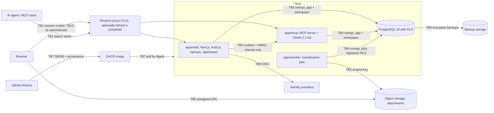

# noergo threat model

**Status: draft, not approved.** "Planned implementation" is the design; "residual" is
the risk expected after the planned controls, to be re-rated once tests produce
evidence. The agents' boundary (TB2, TB3: MCP server, OAuth server, consent page) is
built since 2026-10-19, and the administration (TB10) since 2026-10-20; their rows cite
the tests that ran. A test that ran covers the cases it names, not the whole test family.

## Metadata

- **System:** noergo: `apps/web`, `apps/mcp`, `apps/worker`, `packages/core`, the
  container image and its CI pipeline.
- **Version / commit / date:** 0.1.0-dev, pre-initial-commit, 2026-10-18.
- **Owner:** maintainer.
- **Independent reviewers:** none yet (see open decision 4).
- **Assurance profile:** E (includes B). See [PROJECT_PROFILE.json](PROJECT_PROFILE.json).
- **Trigger:** initial design, phase F0. Revised 2026-10-20: noergo became open source
  only, the unused billing design was removed (TM-28 to TM-30 retired) and an
  administration inside the app
  was added (TB10, TM-40 to TM-43).
- **Baseline:** the maintainer's security baseline, catalog 1.0.0 (controls and test
  families reviewed 2026-07-31), mirrored privately. Control ids (`IAM-008`) and test
  family ids (`T-IAM-008`) refer to it. A control is linked to a test family only
  through that family's `control_refs`.

## Objectives and invariants

1. No request reads, writes, indexes or logs content of another workspace. An id
   from another workspace answers `not_found`.
2. An agent or token never exceeds the workspace, scopes, read-only flag and agent
   access of its connection.
3. Every agent write is attributed to its connection and is revertible: a note
   revision exists before an agent changes a note.
4. *(Retired 2026-10-20: noergo has no billing.)*
5. Note content never executes in the browser and cannot load external resources.
6. No secret is in the repository, the image or the logs.
7. Revoking a session (epoch), an agent connection or a token takes effect on every
   channel within 60 seconds.
8. Deleted data leaves production within the stated windows (trash: 30 days) and
   leaves backups when the backup retention expires.
9. The image that runs is the one CI built from reviewed source, with verifiable
   provenance.
10. Only an account with the `admin` role whose e-mail is in the current
    `NOERGO_ADMIN_EMAILS` changes other accounts or the instance's settings, and each
    change is in `audit_log`, written in the same transaction.
11. A blocked account reaches nothing: no sign-in, session, personal token or agent
    grant works until it is unblocked, and unblocking does not revive old sessions.

## Assets and impact

| Asset | Where | Confidentiality | Integrity | Availability | Privacy / fraud |
|---|---|---|---|---|---|
| Notes, revisions, links, layouts | PostgreSQL | high | high | medium | high: free-form, may hold sensitive data |
| Attachments | column covers: PostgreSQL `attachments.content` (re-encoded WebP, at most 2 MB); planned: object storage for the rest | high | medium | medium | high: images and documents, EXIF |
| Identity and profile (email, name, avatar URL, locale, signup country) | `users`, `accounts` | medium | high | medium | medium |
| Session and signing keys (Auth.js secret, OAuth keys, consent-bridge HMAC key) | runtime environment | high | high | high | high: account takeover at scale |
| OAuth clients, grants, codes, access and refresh tokens | `oidc_payloads` | high | high | medium | high |
| Personal API tokens (`nrg_…`) | `api_tokens`, sha256 only | high | high | low | high |
| Instance settings and account state (sign-up policy and list, agent access, storage quota; role, blocked, agents enabled) | `settings`, `users` | low | high | medium | high: one change opens sign-up or agents to everyone |
| Change log and activity | `changes` | medium | high | medium | medium |
| Audit and security events (IP-derived keys) | `audit_log`, `security_events`, host logs | medium | high | medium | medium |
| Backups (WAL archive, daily dumps) | backup storage | high | high | high | high |
| Source, CI, release image, provenance | GitHub, GHCR | low (public) | high | medium | high: supply chain |
| Domain and DNS (`noergo.com`) | DNS/CDN provider | low | high | high | high: phishing, takeover |

## Actors

| Actor | Starting position and capability |
|---|---|
| Anonymous | Reaches the landing page, sign-in, OAuth discovery, DCR and token endpoints. Can run bots. |
| User | Signed in, owns one workspace. May be curious or malicious toward other workspaces. |
| Compromised user | An attacker holding a user's session, provider account, personal token or agent token. |
| Other tenant | A legitimate user trying to reach another workspace by ids, search, streams, files or jobs. |
| Malicious or compromised AI agent / MCP client | Holds a valid grant; can call every tool its scopes allow, at machine speed. |
| Prompt-injected agent | A well-meaning agent steered by text inside a note, a web page or another tool's output. |
| Rogue DCR client | Registers itself anonymously, picks its name and redirect URIs, tries consent phishing. |
| Instance administrator | An account with the `admin` role and an e-mail on `NOERGO_ADMIN_EMAILS`. Through the app: blocks and unblocks accounts, ends their sessions, enables agents, revokes connections and tokens, changes sign-up, agent access and quota. Sees e-mails, names and connection metadata, never note content. Can be phished like anyone. |
| Insider / operator | Has production, DNS and repository access; account can be phished. |
| Supply-chain attacker | Publishes a malicious package, compromises an Action or base image, or sends a malicious pull request. |
| Self-host operator | Runs the image with their own configuration; may misconfigure it (not an attacker, but a source of exposure). |
| Identity provider | Trusted for its function; its tokens are still verified. |

## Data flows and trust boundaries

| Boundary | Identity at the hop | What crosses | Main controls |
|---|---|---|---|
| TB1 browser ↔ web | Auth.js JWT session cookie, checked against `users.session_epoch`; Origin on mutations | notes, profile, ops, SSE stream | CSP with nonce, CSRF/Origin, input limits, rate limits |
| TB2 agent ↔ mcp | opaque OAuth access token bound to the `/mcp` resource, or a personal `nrg_` token | tool calls and results with note content | PKCE S256, resource indicators, scopes, read-only flag, 120 calls/min, entitlement per call |
| TB3 web ↔ mcp consent bridge | HMAC from web plus the browser's original cookies | interaction uid, user id, consent decision | internal endpoint only, `interactionDetails` over the original cookies |
| TB4 services ↔ PostgreSQL | database role plus transaction-local `app.workspace_id` | everything | RLS ENABLE + FORCE, fail-closed policy, explicit `workspace_id` filter, role grants |
| TB5 browser / worker ↔ object storage | short-lived presigned URL; key scoped to the buckets | attachments | quarantine, magic bytes, re-encode, cookieless origin |
| TB5a browser ↔ web, column covers (built) | session cookie; Origin on the upload | image bytes up and down | `POST /api/files`: magic bytes, decode and re-encode in the request; `GET /api/files/[id]` under RLS, same origin, sandbox CSP |
| TB6 *(retired 2026-10-20)* | — | — | noergo has no payment provider |
| TB7 CI → registry → host | GitHub workflow identity; image digest and attestation | source, image | pinned actions and images, SBOM, provenance |
| TB8 web ↔ identity providers | OIDC client with PKCE, state and nonce | email, name, avatar URL, locale | issuer and audience validation; provider tokens not stored |
| TB9 operator ↔ host, database, backups | maintainer accounts with MFA | everything | audited access, encrypted backups |
| TB10 administrator ↔ web administration | session cookie as in TB1, plus `role = 'admin'`, not blocked, and an e-mail in the current `NOERGO_ADMIN_EMAILS`, checked on every page and action and again in the writing transaction | account state, agent access, revocations, sign-up policy and list, quota | 404 for everyone else, zod on the settings patch, Next.js Origin check on server actions, `audit_log` in the same transaction, no note content and no deletion |

**Personal data.** Collected: email, name, avatar URL, locale, signup country,
terms version and acceptance time, IP addresses (rate limiting and security events),
note content, attachments, agent connection metadata (client name, redirect host, last
use), account state set by an administrator (blocked since, agents enabled) and the
administrators' actions (`audit_log`). Not collected: passwords, identity-provider OAuth
tokens, payment data of any kind.

**Regions and third parties.** Production runs in one hosting region, declared in
the privacy notice. Users are in Brazil, the EU and China, so at least two of these
populations have their data processed abroad. US-based providers (identity, CDN/storage,
GitHub) add further transfers. Connected AI agents receive what the
tools return, at the user's request, under the agent provider's own terms.

**AI system inventory.** noergo runs no model of its own. It exposes MCP tools to
agents the user connects (`apps/mcp/src/mcp/tools.ts`). Read: `search`, `fetch`,
`list_boards`, `get_thought`, `get_open_thought` (the thought on the person's screen,
from `user_focus`, kept 10 minutes), `get_recent_activity`. Write: `create_board`,
`create_thought`, `update_thought`, `add_notes` (up to 50 ideas and their links in one
transaction), `update_note`, `append_to_note`, `edit_note_text`, `connect_notes`,
`disconnect_notes`, `move_note`, `place_ideas`, `organize_map` (a layout, colours and
folds; nothing deleted), `archive_note`. Autonomy is the agent's; noergo bounds
it with consent per connection, scopes, read-only connections, rate limits,
reversibility and attribution. The development process uses AI coding assistants;
their output is reviewed and tested like any other contribution.

## Threats and abuse cases

States are not repeated here: every linked control is `NOT_TESTED` (see
[CONTROL_MATRIX.md](CONTROL_MATRIX.md)). Tests are catalog family ids whose
`control_refs` include the listed controls.

### A. Tenant isolation and authorization

| ID | Threat | Controls | Planned implementation | Tests | Evidence (planned) | Residual |
|---|---|---|---|---|---|---|
| TM-01 | IDOR/BOLA: a user or agent names ids of another workspace in `/api/ops`, MCP tools, stream resume or export. | IAM-008, ARC-004, IAM-007 | Every op and read runs in `withWorkspace()`: RLS ENABLE + FORCE with `workspace_id = app_workspace_id()`, which is NULL when unset, so nothing matches. Every query also filters by `workspace_id`. Composite FKs `(id, workspace_id)`. Foreign ids answer `not_found`. The workspace comes from the session or token, never from the request. | T-IAM-008, T-ARC-004, T-IAM-007 | Integration tests in `packages/core/test/domain.test.ts`; MCP: every tool that takes an id, called with ids of another workspace, answers `not_found` and changes nothing there (`apps/mcp/test/tools.test.ts`, executed 2026-10-19). API suite pending. | low |
| TM-02 | Cross-tenant leak through search, snapshot, activity, export or the change stream. | ARC-004, IAM-008 | `packages/core/src/read.ts` reads inside `withWorkspace()` with explicit filters. `pg_notify` carries only `<workspace>:<seq>`; the stream sends a session only its own workspace and reads changes under RLS. Exports use a read-only snapshot of one workspace. | T-ARC-004, T-IAM-008 | Two-tenant test for search, export and stream (no test covers search across workspaces yet). | low |
| TM-03 | BFLA: a user reaches the administration (`/<language>/admin`, its server actions), an account without agent access reaches MCP, a read-only connection writes, or (once sharing exists) a viewer writes. | IAM-007, IAM-009 | Administration (inside web, see Decisions): every page calls `requireAdmin()` and every action `currentAdmin()`, both through core `isAdmin` (role `admin`, not blocked or deleted, e-mail in the current `NOERGO_ADMIN_EMAILS`), and core checks it again inside the writing transaction (`asAdmin`); everyone else gets 404. Agent access per MCP call (`agentAccessAllowed`, 60 s cache): mode `all` or `granted`, then `agents_allowed`. Scopes and read-only flag enforced in `executeOps` (`packages/core/src/ops/execute.ts`). `workspace_members.role` is not enforced yet and must be before sharing ships. | T-IAM-007, T-IAM-009 | `packages/core/test/admin.test.ts` "knows an administrator only while they hold the role and stay on the list"; `e2e/admin.spec.ts` "an account that is not an administrator finds no administration" (404 on the pages, no menu link); `agents.test.ts` agent access by mode. Executed locally on 2026-10-20. Authorization matrix per route and tool pending. | medium: administration on the app's origin and session, no step-up (open decision 5) |
| TM-04 | Mass assignment: `workspace_id`, `version`, `created_by`, `deleted_at` or actor ids smuggled into an op. | IAM-008, APP-001 | Zod discriminated union in `packages/core/src/ops/schema.ts`: only declared fields survive (unknown keys are stripped; link style is strict). `executeOps` trusts its input, so every writer parses first: the web's `/api/ops`, and the MCP tools in `apply()` (`apps/mcp/src/mcp/tools.ts`). Until 2026-10-20 the MCP tools handed their ops to `executeOps` unparsed: trimming, length and URL rules were skipped and only the database CHECKs stood behind them. `applyOp` writes explicit columns; actor and workspace come from server context. | T-IAM-008, T-APP-001 | Unit tests in `packages/core/test/pure.test.ts` (written, not executed); "extra privileged field has no effect" test. MCP "runs every write through the op schema the web uses: trimmed titles, well-formed websites" in `apps/mcp/test/tools.test.ts`, which failed before the fix and passes after it (executed locally on 2026-10-20). | low |
| TM-05 | Worker as confused deputy: a forged or tampered job makes the RLS-bypassing worker act on another workspace. | ARC-002, ARC-004, APP-012 | Job payloads carry ids only and are validated; the worker re-reads rows and takes `workspace_id` from the database, never from the payload; jobs are idempotent. Narrow the grants: `packages/core/sql/database.sql` currently gives both runtime roles DML on every table, queue tables included. | T-ARC-002, T-ARC-004, T-APP-012 | Worker tests with tampered payloads; grant review. | medium |

### B. Identity, sessions, OAuth and MCP

| ID | Threat | Controls | Planned implementation | Tests | Evidence (planned) | Residual |
|---|---|---|---|---|---|---|
| TM-06 | Session swap on consent: the attacker starts an authorization with their client and lures the victim into approving it, or replays the internal consent call. | IAM-011, IAM-005, APP-007 | `/oauth/interaction/[uid]` checks the session and epoch, then forwards the browser's original Cookie header with an HMAC to an internal mcp endpoint, which runs `interactionDetails` over those cookies: only the browser that started the flow can finish it. The HMAC covers uid, method and time and is compared in constant time; the endpoint is not routed by the proxy. | T-IAM-011, T-IAM-005, T-APP-007 | `e2e/agents.spec.ts` (executed 2026-10-19): the consent link opened in another browser, signed in as someone else, shows "expired" and its confirm endpoint refuses. | low |
| TM-07 | Refresh-token replay after theft from a client or its logs. | IAM-011, IAM-010 | Opaque, short-lived access tokens; refresh rotation; reuse revokes the grant and is logged (any grace period for parallel refreshes stays short); tokens bound to `/mcp` by resource indicators; revocation in Settings. | T-IAM-011, T-IAM-010 | `e2e/agents.spec.ts` (executed 2026-10-19): DCR → authorize → consent → token → MCP → refresh; a replayed refresh token revokes the grant, ends the connection and is logged as `oauth_refresh_reuse` (high). | medium: bearer tokens, no sender constraint |
| TM-08 | DCR abuse: mass registration, phishing names ("noergo official"), look-alike Unicode, misleading logos. | APP-011, IAM-011, ARC-006 | Registration rate-limited per IP; clients without a grant expire; length and character limits on `client_name`; consent shows the redirect host and "unverified app"; `logo_uri` never shown; verified mark only for known vendor redirect hosts; cap on connections per user. | T-APP-011, T-IAM-011, T-ARC-006 | Registration-limit and consent-screen tests. | medium: consent phishing remains possible |
| TM-09 | Open redirect or code interception: lax `redirect_uri`, loopback misuse, Auth.js `callbackUrl`, the bridge's `returnTo`. | IAM-011, APP-001 | Exact redirect matching; only all-loopback redirects become native clients with a variable port (RFC 8252); PKCE S256 required; errors for unknown redirects render a page; `callbackUrl` same-origin only; `returnTo` accepted only as an mcp-issued path. | T-IAM-011, T-APP-001 | Protocol tests. | low |
| TM-10 | Token or identity confusion: a token for another resource accepted; multi-tenant Microsoft issuer not validated; auto-linking by an unverified email takes over an account. | IAM-011, IAM-001 | `/mcp` is the only resource and other audiences are rejected; issuer validated per tenant; Google links by email only when `email_verified` (Gmail or hosted domain); Microsoft and generic OIDC never auto-link. | T-IAM-011, T-IAM-001 | Claim and issuer tests with synthetic tokens. | low |
| TM-11 | A revoked session or token keeps working on long-lived channels (SSE, MCP), or after the account is blocked or loses agent access. | IAM-005, APP-013 | Epoch checked when a stream opens and periodically; streams close on epoch change, logout, blocking and deletion; MCP checks opaque tokens and the account on every call; agent-access cache at most 60 s. | T-IAM-005, T-APP-013 | MCP part: `e2e/agents.spec.ts` (executed 2026-10-19), a disconnected agent gets 401 on its next call and its refresh token is refused. Blocking: see TM-42. SSE part pending. | low |
| TM-12 | Token theft from a database copy. | IAM-010, CRY-003 | `nrg_` tokens stored only as sha256 and shown once (`api_tokens.token_hash`); the `oidc_payloads` adapter must key codes and tokens by a hash, not their value; default expiry for personal tokens (`expires_at` is optional today); session JWTs are not stored. | T-IAM-010, T-CRY-003 | Adapter test: no raw token value in `oidc_payloads`. | medium until the adapter hashes |
| TM-13 | Email-code guessing and account enumeration (optional `AUTH_EMAIL_CODE`). | IAM-003, IAM-004 | Random, short-lived, single-use codes stored as hashes with an attempt counter (`email_codes`); rate limits per email and per IP; the same answer for known and unknown emails. | T-IAM-003, T-IAM-004 | Tests with synthetic accounts. | low |
| TM-14 | CSRF on mutations: ops, settings, token creation, administration actions. | APP-007 | Origin check on every mutation; SameSite cookies; JSON content type required; Auth.js CSRF token on its routes; Next.js compares the Origin of server actions (agents, administration) with the host. | T-APP-007 | Cross-origin tests. | low |
| TM-15 | Critical action with a stolen or stale session: delete the account, export, create a personal token, grant an agent write access. | IAM-006, IAM-002 | Recent sign-in with the provider required for these actions, with a confirmation naming the action. **Not in the current design.** | T-IAM-006, T-IAM-002 | — | high until step-up exists |

### C. AI agents and untrusted content

| ID | Threat | Controls | Planned implementation | Tests | Evidence (planned) | Residual |
|---|---|---|---|---|---|---|
| TM-16 | Prompt-injected agent writes markdown that exfiltrates through images or links. | AI-002, APP-002, APP-008 | DOMPurify, no raw HTML; CSP `img-src 'self'` plus the attachments origin, so external image beacons never load; links with `rel="noopener noreferrer"` and their host visible; strict Referrer-Policy. | T-AI-002, T-APP-002, T-APP-008 | Corpus of exfiltration payloads rendered in the app. | medium: a user can still click a crafted link |
| TM-17 | Prompt-injected agent abuses noergo tools: mass archive, rewrites, moves, planted instructions for later agents. | AI-002, AI-003, AI-005 | Tool descriptions say note content is data; scopes and read-only enforced server-side; no permanent-delete tool (archive goes to a 30-day trash); a revision before every agent write; activity feed with revert; 120 calls/min per connection; tool annotations let clients ask the person. | T-AI-002, T-AI-003, T-AI-005 | "keeps a revision before an agent rewrites a note" in `domain.test.ts`; `apps/mcp/test/tools.test.ts` (executed 2026-10-19): read-only and not-enabled connections refused, a body replaced only at the version read, archive is the trash. Injection evals pending. | medium: noergo cannot stop an agent from passing what it read to tools outside noergo |
| TM-18 | Malicious or compromised MCP client reads all it was granted, or writes at volume. | AI-003, APP-011, LOG-001 | Consent per connection, read-only option, per-connection rate limit, 50 ops per batch, 100k notes per workspace, last use shown, revocation within 60 s, events for connect, revoke and unusual write rates. | T-AI-003, T-APP-011, T-LOG-001 | `packages/core/test/agents.test.ts` (executed 2026-10-19): read-only refusal, token limit, revocation, event coalescing. Rate-limit test at `/mcp` pending. | medium: granted access is real access |
| TM-19 | Tool output gives the agent provider more than it needs (other workspaces, internal ids, emails, secrets). | AI-004, DAT-002 | Tools return only the bound workspace; search returns 280-character excerpts, full bodies only through `fetch`; no tokens or emails in tool output; the privacy notice says connected agents' providers receive tool results. | T-AI-004, T-DAT-002 | `apps/mcp/test/tools.test.ts` (executed 2026-10-19): tool contract snapshot (names, annotations, schemas) and outputs free of the e-mail, user id, workspace id and internal columns. | low |

### D. Input, files and the browser

| ID | Threat | Controls | Planned implementation | Tests | Evidence (planned) | Residual |
|---|---|---|---|---|---|---|
| TM-20 | Stored XSS through note bodies, titles, link labels or `javascript:` / `data:` URLs, including a thought's website (set by the person or by an agent). | APP-002, APP-008, APP-001 | React escaping; markdown without raw HTML through DOMPurify; note links limited to http, https and mailto by zod and a database CHECK; a thought's website limited to http and https by zod and a CHECK on `lanes.url` (migration 0004), and the web refuses a user name before the host (`https://bank.com@evil.example`); every such link opens with `rel="noopener noreferrer nofollow ugc"` and names its host; a board's icon is one RGI emoji or a name from `BOARD_ICONS` (zod with the `v` flag, `packages/core/src/board-icons.ts`, and a length CHECK on `boards.icon`, migration 0005) and is drawn as text or as one of noergo's own SVGs; a board's tab colour and background are `#rrggbb` (zod and a CHECK on `boards.background`) and reach the page only as CSS custom property values; nonce CSP without `unsafe-inline` scripts; `X-Frame-Options: DENY`. | T-APP-002, T-APP-008, T-APP-001 | "rejects scriptable links" and "takes only an http(s) address as a thought's website" in `pure.test.ts`; "keeps a thought's website, and refuses a scriptable one even past the op schema" in `domain.test.ts` (the CHECK); `apps/web/test/site.test.ts`; MCP "gives a thought its website… and refuses one a click could run"; e2e "the brush renames a thought and gives it a website". Executed locally on 2026-10-19. "takes one emoji or a noergo icon name as a board's icon, and nothing else" (`` refused) in `pure.test.ts`; "keeps a board's icon and background, and the database refuses what the op schema would" in `domain.test.ts`; MCP "gives a board an icon and colours… and refuses an icon that is not one emoji"; `e2e/board-look.spec.ts`. Executed locally on 2026-10-20. | low |
| TM-21 | Unbounded bodies, batches, layouts, tags or queries exhaust CPU, memory or storage. | APP-001, APP-011 | `packages/core/src/limits.ts`: 100k characters per body, 50 ops per batch, 500 nodes per layout op, 50 tags, 100k notes per workspace, 50 search results, 200-character queries; CHECKs in `0001_initial.sql`; 15 s statement timeout; small request bodies at the proxy. | T-APP-001, T-APP-011 | Schema tests (written, not executed); edge limit tests. | low |
| TM-22 | Attachment polyglots, SVG or HTML with script, decompression and pixel bombs. | APP-004, APP-006, APP-008 | **Column covers (built):** `POST /api/files` with Origin check, session, 30 uploads/min per person, body read up to 12 MB within 30 s; PNG/JPEG/WebP/GIF by magic bytes only (SVG never); sharp decodes with `limitInputPixels` (50 Mpx), `failOn: 'error'`, one frame, at most 1600 px a side, and re-encodes to WebP, so the stored bytes are written by the server; stored at most 2 MB (database CHECK); served as `image/webp` with `nosniff`, `default-src 'none'; sandbox`, `Cross-Origin-Resource-Policy: same-origin`. **Other attachments (planned):** presigned upload into quarantine; generated keys; short-lived presigned URLs from a separate cookieless origin; non-images as `Content-Disposition: attachment`; 50 MB per file. | T-APP-004, T-APP-006, T-APP-008 | Covers: `apps/web/test/image.test.ts` (SVG and fake PNG refused, pixel bomb refused, trailing payload dropped, one GIF frame); `e2e/customize.spec.ts` (SVG bytes sent as PNG answer 422). Other attachments: fixture corpus (F6 gate). | low on noergo.com; covers are served from the app origin, see TM-34 |
| TM-23 | EXIF location and device data leak through images. | DAT-002, APP-004 | Re-encoding strips metadata: covers before they are stored, other attachments before they leave quarantine. The orientation is applied to the pixels first. | T-DAT-002, T-APP-004 | Covers: `apps/web/test/image.test.ts` (a JPEG with camera and GPS EXIF comes out without EXIF or XMP). | low |
| TM-24 | Quota race: parallel uploads overshoot the storage quota (250 MB per account unless the administrator changes it). | APP-014, APP-011 | `UPDATE … SET storage_bytes = storage_bytes + n WHERE storage_bytes + n <= COALESCE(workspace quota, instance quota)` in the same transaction as the insert (built for covers, `packages/core/src/files.ts`); the same picture twice is stored and charged once; reservation released when quarantine rejects (planned). | T-APP-014, T-APP-011 | `packages/core/test/domain.test.ts` "column covers" (charged once, refused past the quota, nothing charged on refusal). Parallel-upload test still to write (F6 gate). | low |
| TM-25 | SSRF through OAuth client metadata (`jwks_uri`, `sector_identifier_uri`, `request_uri`) or a future client-metadata fetch. | APP-005, OPS-004 | Disable `request_uri` and fetch-based client authentication; never fetch note URLs server-side (no link unfurling); any future fetch through an allowlisted egress path that blocks private ranges; production egress allowlist. | T-APP-005, T-OPS-004 | Pinned OAuth-server configuration test. | low |

### E. Availability

| ID | Threat | Controls | Planned implementation | Tests | Evidence (planned) | Residual |
|---|---|---|---|---|---|---|
| TM-26 | Stream exhaustion: many SSE or MCP streams per user or IP, slow readers, notification storms. | APP-013, APP-011, OPS-005 | Caps on concurrent streams per user and IP, heartbeat and idle timeout, bounded buffers, tiny notifications, resume by `seq` with a reload when too far behind (`changesSince` reset). | T-APP-013, T-APP-011, T-OPS-005 | Limited load test on an ephemeral local or CI instance under written scope. | medium: single host |
| TM-27 | Automated abuse of `/mcp`, `/oauth/*` and `/.well-known/*`, which CDN bot protection cannot filter because AI vendors' servers must reach them. | APP-011, OPS-005, LOG-004 | Origin rate limits per IP, client and connection; database timeouts and pool limits (`packages/core/src/db/index.ts`: statement 15 s, idle in transaction 30 s, connect 5 s); alerts on spikes. | T-APP-011, T-OPS-005, T-LOG-004 | Rate-limit and alert tests. | medium |

### F. Retired

TM-28 to TM-30 covered a billing design that was never switched on and was removed on
2026-10-20 (migration 0006). The ids are not reused.

### G. Data, logs and operations

| ID | Threat | Controls | Planned implementation | Tests | Evidence (planned) | Residual |
|---|---|---|---|---|---|---|
| TM-31 | OAuth codes, tokens or note content leak into logs, traces or error reports. | LOG-002, CRY-005 | Proxy log format redacts `code=`, `token=` and `state=`; Authorization headers, cookies, tool arguments and bodies never logged; error reports scrubbed. | T-LOG-002, T-CRY-005 | Canary markers searched across all logs. | low |
| TM-32 | Audit trail altered after an application compromise. | LOG-003, LOG-005 | Runtime roles get INSERT only on `audit_log` (today: full DML through default privileges); security logs shipped off the host with restricted access and set retention. | T-LOG-003, T-LOG-005 | — | high until grants change and logs leave the host |
| TM-33 | Backup exfiltration or destruction (ransomware, leaked storage credential). | DAT-010, OPS-006, CRY-003 | WAL archive with PITR plus daily dumps, encrypted before leaving the host; backup credentials can write but not delete or overwrite; separate from attachment credentials; monthly restore drill in isolation; deleted accounts leave backups when retention expires. | T-DAT-010, T-OPS-006, T-CRY-003 | Restore-drill record (F1 gate). | medium |
| TM-34 | Self-host misconfiguration: `SIGNUP=open` on a public instance, no TLS, weak database passwords, `STORAGE=local` serving files from the app origin, database port exposed. | ARC-003, OPS-002, APP-004 | Refuse to start without required secrets; no default passwords (bootstrap takes them as parameters); with `STORAGE=local`, files only as attachments with a sandbox CSP and `nosniff`, from a separate origin when configured; hardening checklist in the self-hosting guide. | T-ARC-003, T-OPS-002, T-APP-004 | Startup-check tests. | medium: depends on the operator |
| TM-35 | Insider access to notes, or a phished maintainer account. | IAM-009, LOG-005, PEO-004, IAM-002 | No impersonation feature; the administration shows no note content; production database access only through an audited path; phishing-resistant MFA on every maintainer account; administration actions in `audit_log` (since 2026-10-20); the privacy notice says notes are not end-to-end encrypted. | T-IAM-009, T-LOG-005, T-PEO-004, T-IAM-002 | Access review. | medium, to be accepted and disclosed |

### H. Supply chain

| ID | Threat | Controls | Planned implementation | Tests | Evidence (planned) | Residual |
|---|---|---|---|---|---|---|
| TM-36 | Malicious pull request steals CI secrets or plants code. | SUP-005, SUP-006 | Fork PRs run without secrets; no `pull_request_target` with PR code; read-only workflow permissions by default; release job in a protected environment; branch protection with required checks; CODEOWNERS on migrations, auth, OAuth/MCP, administration and CI; DCO. | T-SUP-005, T-SUP-006 | Exported repository and workflow settings. | medium: single maintainer, no independent reviewer |
| TM-37 | Dependency confusion, typosquat or malicious install script. | SUP-002, SUP-007, SUP-003 | `package-lock.json` with integrity hashes and `npm ci`; workspace packages are `private` under `@noergo` (reserve the npm scope); install scripts allowlisted (`allowScripts`); diligence for new dependencies; `npm audit` in `npm run check`; Dependabot. | T-SUP-002, T-SUP-007, T-SUP-003 | CI logs. | medium |
| TM-38 | Compromised Action or base image produces a backdoored release. | SUP-002, SUP-004, SUP-001, OPS-007 | Actions pinned by commit SHA, base images by digest; SBOM and provenance attestation per image; deploy pulls by digest and verifies the attestation first; self-hosting docs show how to verify. | T-SUP-002, T-SUP-004, T-SUP-001, T-OPS-007 | Verification log at deploy. | medium: deploy-side verification is not designed yet |
| TM-39 | Secret committed to the public repository. | CRY-005 | gitleaks pre-commit hook (`.githooks/pre-commit`, `.gitleaks.toml` with a rule for `nrg_` tokens) and in CI; push protection and secret scanning; rotation on any exposure. | T-CRY-005 | Clean history scan before the first push. | low |

### I. Administration

| ID | Threat | Controls | Planned implementation | Tests | Evidence (planned) | Residual |
|---|---|---|---|---|---|---|
| TM-40 | Stale or forged administrator: an account keeps the administration after its e-mail leaves `NOERGO_ADMIN_EMAILS`, a person gives themselves the role, or a blocked administrator acts. | IAM-009, IAM-007 | The list is env-only, never a setting; the role follows the list at every sign-in; `isAdmin` requires the role, an e-mail on the current list and no `blocked_at` or `deleted_at`, on every request and again inside the writing transaction. | T-IAM-009, T-IAM-007 | `packages/core/test/admin.test.ts` "knows an administrator only while they hold the role and stay on the list" (executed locally on 2026-10-20). | low |
| TM-41 | A settings change opens sign-up or agents to everyone (a stolen administrator session, a forged request), or a malformed list lets in more than intended. | IAM-009, APP-001, APP-007, LOG-005 | `settingsPatchSchema` (zod): enumerated modes; list entries trimmed, lowercased, a whole address or an `@domain`, at most 1000; quota 1 MB to 1 TB; `null` hands a setting back to the environment. Precedence decided only in `instanceSettings()`. The page shows where each value comes from. `audit_log` keeps who saved what. The `settings` row cannot be inserted or deleted by the runtime roles, nor updated by the worker's. | T-IAM-009, T-APP-001, T-APP-007, T-LOG-005 | `admin.test.ts` "takes a setting from the administrator, else the environment, else the default" (with the audit line); `e2e/admin.spec.ts` "sign-up follows what the administrator saves, and goes back to the environment". Executed locally on 2026-10-20. Schema edge cases (`@`, spaces, 1001 entries) not yet tested. | medium: no step-up for administrators (open decision 5) |
| TM-42 | Block bypass: a blocked account keeps working through an open session, another linked provider, a personal token, an agent grant or a refresh. | IAM-005, IAM-007 | Refused in `signInFederated` before any write (whatever the provider), `sessionState`, `principalFromToken`, `principalFromGrant`, `agentAccessAllowed` and the OAuth provider's `findAccount`, so refresh fails too. Blocking bumps `session_epoch`; tokens and connections are kept but inert. | T-IAM-005, T-IAM-007 | `admin.test.ts` "blocks an account out of sessions, sign-in, tokens and connections, and lets it back"; `e2e/admin.spec.ts` "an administrator blocks an account out of its session and sign-in, and lets it back". Executed locally on 2026-10-20. The refresh refused at `findAccount` has no test yet; open SSE streams follow TM-11. | low |
| TM-43 | An administrator misuses the role: blocks people, revokes their agents, or locks the other administrators out. | IAM-009, LOG-005 | No deletion, no note content and no impersonation in the administration; an administrator cannot block themselves or anyone on the list; every action in `audit_log` with who, what and when. | T-IAM-009, T-LOG-005 | `admin.test.ts` "never blocks the administrator acting, nor anyone on the list" and the audit lines of each action (executed locally on 2026-10-20). | medium: `audit_log` is writable by the runtime role until TM-32 is closed |

## Decisions

- **Avoid:** no passwords; identity-provider tokens not stored; no impersonation; no
  server-side fetching of note URLs; no raw HTML in markdown; no permanent-delete
  tool for agents.
- **Reduce:** the planned implementations above.
- **Transfer:** identity proofing and primary MFA to the identity providers.
- **Administration inside the app (2026-10-20).** The design for TM-03 and IAM-009 asked
  for an isolated administration surface. The administration is instead pages of web, on
  the app's origin and session, so a self-hosted instance needs nothing more to run it.
  Compensating controls: the per-request check against the env list, the re-check in the
  writing transaction, 404 for everyone else, `audit_log`, and no note content and no
  deletion in it. Until open decision 5 is settled, a stolen administrator session can
  change the settings and block accounts; it cannot read notes or delete anything.
- **Accept (pending, needs an exception record, none approved):** the operator can
  read note content (no end-to-end encryption); exfiltration by a user's agent
  through tools outside noergo; review by a single maintainer.

## Open decisions

1. **Sensitive data and minors (DAT-007, profile C).** Notes are free-form and may
   hold sensitive personal data; there is no age gate. Decide whether to add DAT-007
   to the selection and run a minors triage, or record why not.
2. **Access-log retention in Brazil.** Brazilian law on internet applications
   requires for-profit application providers to keep access logs for six months; the
   design keeps IP data only in hashed rate-limit and security events. Needs legal
   review against minimization.
3. **GDPR and China's PIPL.** EU representative, transfer mechanisms and consent
   rules for cross-border transfers are not covered by baseline controls beyond
   DAT-008. Needs legal review.
4. **Independent review.** With one maintainer, independent review (SUP-006),
   independent retest (VUL-005) and segregation of duties (IAM-009, PEO-004) cannot
   be met as written: an exception or an external reviewer is needed.
5. **MFA and step-up.** Sign-in is delegated to identity providers; admin MFA
   (IAM-002) and recent authentication for critical actions (IAM-006) need a
   mechanism, such as checking authentication-method claims or a local passkey. The
   administration inside the app (see Decisions) depends on it.
6. **Human approval for agent writes (AI-003).** Left to MCP clients; noergo relies
   on reversibility and attribution. Record as a decision or add confirmation for
   bulk actions.
7. **Self-host defaults.** The default for `SIGNUP` and the serving origin for
   `STORAGE=local`.

## Approval and next review

- **Blocking before launch (F7):** TM-15, TM-32, TM-12, TM-38 and open decisions 1
  to 3.
- **Exceptions:** none recorded.
- **Approvers:** maintainer (pending). No independent reviewer yet.
- **Next review:** at every phase gate (F1 to F7), on any change that CONTRIBUTING.md
  marks as security-relevant, and at least every 90 days; no later than 2027-01-18.
